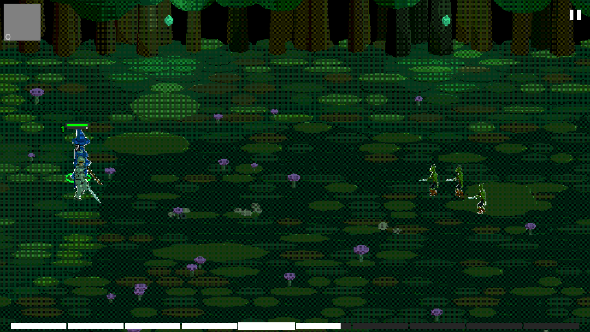
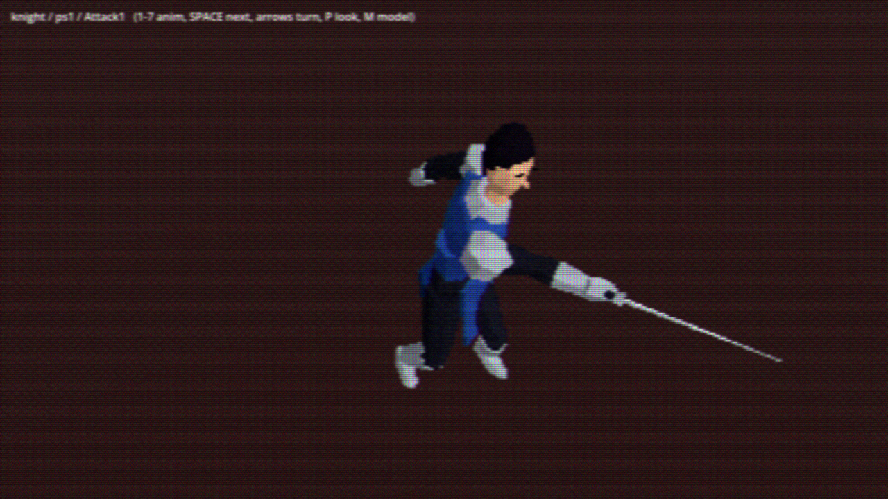

# Crimson Red 3D

- **Genre:** Auto-battler RPG (3D, dimetric view)
- **Language(s):** GDScript (Godot 4); Python scripts that drive Blender (`blender/`); Lua for one data-export tool (`tools/export_data/`); shell launcher scripts
- **Libraries/engine:** Godot 4 (project written for 4.3, GL Compatibility renderer; headless checks pass on 4.7.2); Blender (scripts run headless with 5.2.3 LTS here; no version is recorded in the repo); Flowerwall CRT addon (MIT, switched off by default)
- **Coding concepts demonstrated:** A* pathfinding with string-pulling on a nav grid (`godot/sim/nav_grid.gd`); ORCA collision avoidance with uneven responsibility (`godot/sim/orca.gd`); a layered steering stack (`godot/sim/steer_world.gd`); melee engagement slots in rings around a target (`godot/sim/slots.gd`); a fixed-step deterministic combat sandbox (`godot/sim/sandbox_battle.gd`); spring-damper UI animation (`godot/ui/smooth_value.gd` and siblings); mouse picking against per-unit selection volumes (`godot/view/picking.gd`); data exported from the 2D game to JSON (`tools/export_data/main.lua`, `godot/sim/game_data.gd`); procedural model, rig, animation and gear generation in Blender Python (`blender/build_humanoid.py`, `build_gear.py`, `build_monsters.py`, `build_stage.py`); PS1-style and palette-limited shaders (`godot/shaders/`, `godot/ui/pixel_art.gdshader`); headless tests (`godot/tests/`, `test_3d`)
- **Dates:** 2026-10-28 (the files' real modification dates; the repo history has two earlier commits from the same day)
- **Status:** Prototype. A sandbox battle and menu screens run; the combat rules are mostly placeholders (see below).

## What this is

A 3D port of my 2D auto-battler Crimson Red (LOVE/Lua, which is a separate repo). The goal was to keep the game design and controls but move battles to a 3D ground plane with RTS-style movement: units path around obstacles, avoid each other and queue up around a target in melee slots. Characters, armour, weapons and stages are low-poly models built from Python scripts in Blender and exported to glTF.

Done: the movement and engagement simulation, a sandbox battle (Knight, Wizard and Cleric heroes, goblins, skeletons, witch), ability casting from exported 2D data, five zone stages plus a dungeon, a HUD, and menu screens (title, save select, stage select, party, equip, talents, shop) ported from the 2D game.
Not done: the full encounter rules of the 2D game (damage and HP in the sandbox are placeholders, stagger is not ported), most classes, audio, a real campaign map.

## How it fits together

- `godot/sim/`: no nodes, deterministic, 60 Hz. `nav_grid.gd` finds routes with A* on a 0.5 m grid and straightens them with line-of-sight checks against exact obstacle clearance. `steer_world.gd` runs the stack: order, path, desired velocity, ORCA avoidance (`orca.gd`), stop rules, overlap fix. `slots.gd` hands out melee positions in rings around a target. `sandbox_battle.gd` puts a small combat model on top.
- `godot/view/`: stage and dimetric camera (`stage_scene.gd`), unit rigs (`unit_view.gd`), picking, HUD (`battle_hud.gd`), effects, and the playable sandbox (`sandbox_battle_view.gd`) with an `F` debug overlay (unit radii, paths, goals, melee slots).
- `godot/ui/`: `SmoothValue`, `SmoothVec2`, `SmoothRect`, `SmoothColor`. Every gradual UI change is a spring-damper retargeted at any time.
- `godot/menus/`: the 2D game's menu screens rebuilt as Godot controls on an 800x450 virtual canvas, with a JSON save (`game_state.gd`).
- `godot/data/`: JSON exported from the 2D game by `./export_data` (needs the 2D game's `main-game/` folder next to this project, which is not part of this repo and needs LOVE). `unit_sizes.json` and `wizard_talents.json` are hand-authored.
- `blender/`: scripts that build the shared 24-bone rig, the Knight, mannequin, Goblin, Skeleton and Witch bodies and their animation clips, gear pieces, and the zone stages. `./build_model` rebuilds the character models; the `.blend` sources and `.glb` outputs are included.

## Running

Install Godot 4 (command `godot`, or set `GODOT=/path/to/Godot`).

    ./play_sandbox [--debug]   # sandbox battle; keys 1-4 select, click orders, Q W E cast, SPACE pause, F debug overlay
    ./play                     # menus -> stage select -> battle
    ./view_model --model=knight --clip=Attack1 --gear=helm_iron,armor_scale_mail --weapon=sword_long
    ./view_stage [--units]
    ./test_3d                  # headless checks

First launch may need `godot --headless --path godot --import` (`test_3d` does this).

Screenshots can be taken from the scripts: `--shot=name` on the sandbox, menus and stage viewer, `--shots` / `--sequence` / `--turn` on the model viewer. Output goes to `godot/shots/`.

Notes: the Dedicool font and the skill icon images of the 2D game are not included (no redistribution licence), so the HUD shows the engine's default font and grey icon boxes. The 3D rendering needs a GPU window; the tests run headless.

## AI assistance

This project was built with AI coding agents working from my direction. Evidence in the original working repository: a `codex/...` branch name, an agent instruction file, and planning/status documents written in an agent's voice that record my instructions ("Director") as the source of design decisions (pace, party size, skill trees, camera, look). The agent-written planning documents and instruction files are not included here. Which parts (GDScript simulation, Blender scripts, UI) were written by the agents versus by me, and which tool, are to be confirmed by the owner.

## Credits

- Flowerwall CRT shader addon, MIT licence, Copyright (c) 2024 Art (`godot/addons/flowerwall_crt/LICENSE`).
- Cursor sprites: Kenney, Cursor Pixel Pack, CC0 (`godot/assets/cursor/KENNEY_LICENSE.txt`).
- Item and reward tables in `godot/data/bh_items.json` and `bh_rewards.json` follow those of the mobile game Battleheart, which the 2D game is modelled on; they come from the 2D project's decoded reference data.
- Zone and class icons in `godot/assets/ui/` come from the 2D game.
- ORCA follows van den Berg et al.'s RVO2 approach, re-implemented here.
